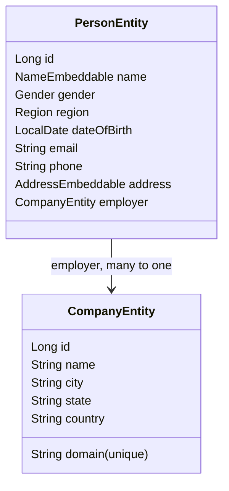

# faux-person-jpa

A small Java application that shows how to use
[faux-person](https://github.com/tauasa/faux-person) with JPA. It generates
random people and saves them to a database, using Hibernate and an H2 file
it creates itself, so it runs with no setup.

```text
$ java -jar target/faux-person-jpa-0.2.0-SNAPSHOT.jar -n 500 --seed 42
seed: 42
saved 500 people to jdbc:h2:file:./data/faux-people
stored: 500 people, 416 companies
largest regions: rok 33, grc 28, naf 27, gbr 26, asia 25
```

Every field faux-person makes is stored, and a saved person reads back as the
same `Person` record. Employers repeat across people, so each company is
stored once, and people point at it.

## Run it

Needs JDK 17 or later and Maven.

```bash
mvn package
java -jar target/faux-person-jpa-0.2.0-SNAPSHOT.jar -n 500 --seed 42
```

`mvn package` puts the jar in `target/` and its dependencies in `target/lib/`,
which the jar's manifest names, so keep the two together. Each run adds to the
database in `./data/`, relative to the folder you run it from. Delete that
folder to start again.

| Option | Does | Default |
|---|---|---|
| `-n, --count N` | How many people to generate and save | 100 |
| `-s, --seed S` | Seed, so a run's people can be generated again | random |
| `-r, --region R` | A faux-person region in lowercase (`jpn`, `rus`, …), or `mixed` | `mixed` |
| `--real-companies` | Real employer names and domains, as faux-person's switch. Their emails could be real inboxes, so never send to one | names end in `[faux]`, domains under `.example` |
| `--db URL` | The JDBC URL to save to | `jdbc:h2:file:./data/faux-people` |
| `-h, --help` | Show the options | |

The seed goes to standard error. A bad argument exits with code 2 and prints
the options. A database that can't be opened exits with code 1.

## How it's built



*Figure: a `person` row holds the name and address as its own columns, and
points at a `company` row, which many people share.*

| Class | Does |
|---|---|
| `PersonEntity`, `CompanyEntity` | The two tables. Gender and region are stored by name, so a new value in faux-person can't change what a stored one means |
| `NameEmbeddable`, `AddressEmbeddable` | A faux-person `Name` and `Address`, as columns of the person's row |
| `PeopleStore` | Opens the database and saves and reads people. `saveAll` writes a whole run in one transaction, so a failure saves nothing, and flushes every 50 people to keep memory flat |
| `App` | The command line |

Each entity has a `from(...)` that copies a faux-person record in, and a
`to...()` that builds the record back. Use `PeopleStore` from your own code
the same way:

```java
import org.tauasa.faux.PersonGenerator;
import org.tauasa.fauxjpa.PeopleStore;

try (PeopleStore store = PeopleStore.open("jdbc:h2:file:./data/faux-people")) {
    store.saveAll(PersonGenerator.builder().seed(42).build().next(100));
    long total = store.count();
    var lovelaces = store.findByLastName("Lovelace");
}
```

The persistence unit is in `src/main/resources/META-INF/persistence.xml`.
Hibernate creates the tables on first use and adds new columns later, but
never drops data. It uses Hibernate's built-in connection pool, which suits
an example and not production. A real application would configure a pool.

### Another database

The app ships with the H2 driver only. For another database, add its JDBC
driver as a dependency, set `jakarta.persistence.jdbc.user` and the driver in
`persistence.xml`, and pass its URL with `--db`. Supply a password through
your own configuration, never in the file: this example keeps no credentials.

## Build and test

```bash
mvn verify
```

The tests use a fresh in-memory H2 database each. They check that 500
people read back exactly as generated, that companies are stored once across
runs, that marked and real companies stay apart, the region summary, the
surname lookup, that a failed save leaves nothing behind, and the command
line. [SPEC.md](SPEC.md) has the full design.

## Versions

faux-person 0.4.0, Hibernate ORM 7.4 (Jakarta Persistence 3.2), H2 2.5 and
JUnit 6, all pinned in `pom.xml`.

## License

MIT. See [LICENSE](LICENSE).
